<h1 align="center">My Achievements Description On Steam</h1>

<h5 align="center">
	Made by:
	<a href="https://www.linkedin.com/in/karol-modzelewski/" target="_blank">Karol Modzelewski</a>
</h5>

## Navigation

- [Getting started](#getting-started)
  - [Goal of this application](#goal-of-this-application)
  - [Features](#features)
  - [Prerequisites](#prerequisites)
  - [Download application](#download-application)
  - [Run application](#run-application)
  - [Helpful commands](#helpful-commands)
  - [E2E tests](#e2e-tests)
  - [Playwright MCP](#playwright-mcp)
- [Tools and technologies](#tools-and-technologies)
- [Quick overview](#quick-overview)
  - [Main page](#main-page)
  - [Manage categories](#manage-categories)
  - [Manage wallpaper](#manage-wallpaper)
  - [Manage game](#manage-game)
  - [Edit mode](#edit-mode)
  - [Description](#description)
  - [Polish version](#polish-version)
  - [Mobile view](#mobile-view)
- [Any questions?](#any-questions)

## Getting started

### Goal of this application:

I keep a list of every game where I got all the achievements in the **Custom Info Box** of my Steam profile. The list also covers games that got new achievements later, so they're no longer 100%. Updating that text by hand after every finished game was slow and error-prone: I had to keep the list sorted, recount every category and fit everything within the Steam limit.

MADOS (**M**y **A**chievements **D**escription **O**n **S**team) generates that text for me. I add a game once, mark its categories, and the application builds the whole description, ready to copy and paste into Steam:

- a legend of my categories, each with a Steam emoticon (e.g. `ːHeartPixː`), a description and the number of its games
- a **COMPLETED** section with the amount of completed games and DLC groups, listed alphabetically with their category emoticons
- a **NEW ACHIEVEMENTS** section, built the same way, for games and DLCs with new achievements to get

The application also generates a wallpaper with the number of completed games, so my desktop always shows the current score.

### Features:

- **Custom categories**: main, length and difficulty categories with a name, description and Steam emoticon. Their order is changed with drag & drop. Main categories can hide their games, which are then summed up as `... and (N) games` instead of being listed
- **100% category**: a fixed category whose emoticon starts every completed entry
- **DLC groups**: every game has a Base game group and optional DLC groups, each with its own New achievements checkbox. Every completed group counts as a finished entry
- **Edit mode**: edit or delete games and groups straight from the description, with a confirmation before anything is deleted
- **Steam size counter**: the description is measured the way Steam limits it (8000 bytes of UTF-8, line breaks counting as 2). Above the limit, the counter turns red and the exact part Steam would cut off is highlighted
- **Hidden information**: categories with 0 games, hidden games and completed groups are presented in the application but never copied
- **Wallpaper**: upload a GIMP 3 `.xcf` file with one text layer (or keep the default one) and generate its `.png` with the number of completed games and groups. One category can be left out of the number in brackets, e.g. `188 (173)`. The wallpaper is regenerated automatically after changes, and in production on Windows it can also be set as the desktop wallpaper
- **Internationalization**: English (default) and Polish, switched with the flags next to the title and remembered in local storage

### Prerequisites:

- [Node.js](https://nodejs.org/)
- [PostgreSQL](https://www.postgresql.org/) with an empty database for each stage you run (e.g. `mados_dev`, `mados_prod`). The backend creates its tables on start outside production
- `backend/.env.stage.dev` and `backend/.env.stage.prod` files (ignored by git) with `APP_PORT=3001`, `DB_HOST`, `DB_PORT`, `DB_USERNAME`, `DB_PASSWORD` and `DB_DATABASE`. All variables are required
- [GIMP 3](https://www.gimp.org/) (`gimp-console-3.exe`), only to generate the wallpaper

### Download application:

1. Download repository or clone it using `git clone https://github.com/karolmodzelewski/my-achievements-description-on-steam.git` command in your empty folder
2. Go to frontend directory and install all dependencies `npm i`
3. Go to backend directory and install all dependencies `npm i`

### Run application:

Frontend:

- `npm run start:dev` - runs on `localhost:4200` with `development` configuration. It uses mock data, so it works without the backend
- `npm run start:prod` - runs on `localhost:4200` with `production` configuration. It sends `/api` requests to the backend on `localhost:3001`

Backend:

- `npm run start:dev` - runs on `localhost:3001` with `development` configuration
- `npm run start:prod` - runs on `localhost:3001` with `production` configuration (run `npm run build` first)

### Helpful commands:

Frontend:

- `npm run test` - run unit tests
- `npm run test:coverage` - run unit tests with a coverage report
- `npm run lint` - lint application
- `npm run lint:fix` - lint application and automatically fixes errors and warnings (if it's supported by specific rules)
- `npm run format` - prettify application

Backend:

- `npm run test` - run unit tests
- `npm run test:coverage` - run unit tests with a coverage report
- `npm run lint` - lint application
- `npm run lint:fix` - lint application and automatically fixes errors and warnings (if it's supported by specific rules)
- `npm run format` - prettify application

### E2E tests:

Both frontend and backend e2e tests run on the `e2e` stage, which uses its own `mados_e2e` database, so development and production data are never touched. They share this database, so don't run frontend and backend e2e tests at once.

Setup (once):

1. Create an empty `mados_e2e` database in PostgreSQL (the backend creates its tables on start)
2. Create `backend/.env.stage.e2e` (ignored by git) with `DB_HOST`, `DB_PORT`, `DB_USERNAME`, `DB_PASSWORD`, `DB_DATABASE=mados_e2e` and `APP_PORT=3101` (all variables are required, like in `.env.stage.dev` and `.env.stage.prod`)
3. Go to frontend directory and install the browsers `npx playwright install chromium firefox webkit` (frontend tests only)

#### Frontend

Playwright tests live in `frontend/e2e`. They run the real frontend against the real backend.

Commands (frontend directory):

- `npm run e2e` - run all tests in Chromium, Firefox and WebKit. It starts the backend (`npm run start:e2e` on `localhost:3101`) and the frontend (`npm run start:e2e` on `localhost:4300`) itself, so it works next to the development servers on 4200 and 3001
- `npm run e2e -- --project=chromium` - run tests in one browser only
- `npm run e2e:ui` - run tests in UI mode
- `npm run e2e:report` - open the report of the last run

Each test creates only the data it needs through the API (in `beforeEach` or as part of the tested flow) and removes it in `afterEach`, which runs even when the test fails. Every test also starts with `resetData` (API only), run by the automatic fixture in `e2e/fixtures/test.fixtures.ts`, so data left by a stopped or interrupted test (also in UI mode) doesn't break the next one. Tests share one database, so don't run two e2e runs at once (e.g. UI mode and `npm run e2e`).

#### Backend

Vitest + supertest tests live in `backend/test` (`*.e2e-spec.ts`). They start the whole application in the process of the tests, set up like in `main.ts` (`configureApp`), with the real `mados_e2e` database, and send real HTTP requests to the API. They don't listen on any port, so they work next to the development servers.

Commands (backend directory):

- `npm run e2e` - run all backend e2e tests (it refuses to run on any stage other than `e2e`)
- `npm run e2e -- test/game.e2e-spec.ts` - run one spec file
- `npm run e2e:coverage` - run all backend e2e tests with a coverage report in `coverage-e2e`

Before every test the database is emptied and the 100% category is created again (`resetDatabase` in `test/helpers/database.helpers.ts`)

### Playwright MCP:

Optional. Lets an AI agent (e.g. Claude Code) open the running application in a browser to check the UI: take screenshots, click elements and read console logs.

1. Add the server once: `claude mcp add playwright -- npx @playwright/mcp@latest` (use `-s user` to make it available in all projects)
2. Restart Claude Code / VS Code so the tools get loaded
3. Run the frontend with `npm run start:dev` and ask the agent to check `localhost:4200`

Screenshots, snapshots and logs are saved to `.playwright-mcp/`, which is ignored by git.

## Tools and technologies:

Frontend:

- Angular 22
- Angular Material 22
- RxJS 7
- TypeScript 6
- Transloco
- Vitest 5
- Playwright
- ESLint
- Husky
- Prettier
- Lint-staged

Backend:

- NestJS 12
- TypeScript 6
- PostgreSQL
- TypeORM
- Joi
- Cross-env
- Class-validator
- Class-transformer
- GIMP 3
- Vitest 5
- ESLint
- Husky
- Prettier
- Lint-staged

## Quick overview

All screenshots are taken in the `development` configuration with mock data.

### Main page:

Everything is on one page: the collapsible Manage categories and Manage wallpaper sections, the Manage game form and the generated description.

| Main Page |
| --- |
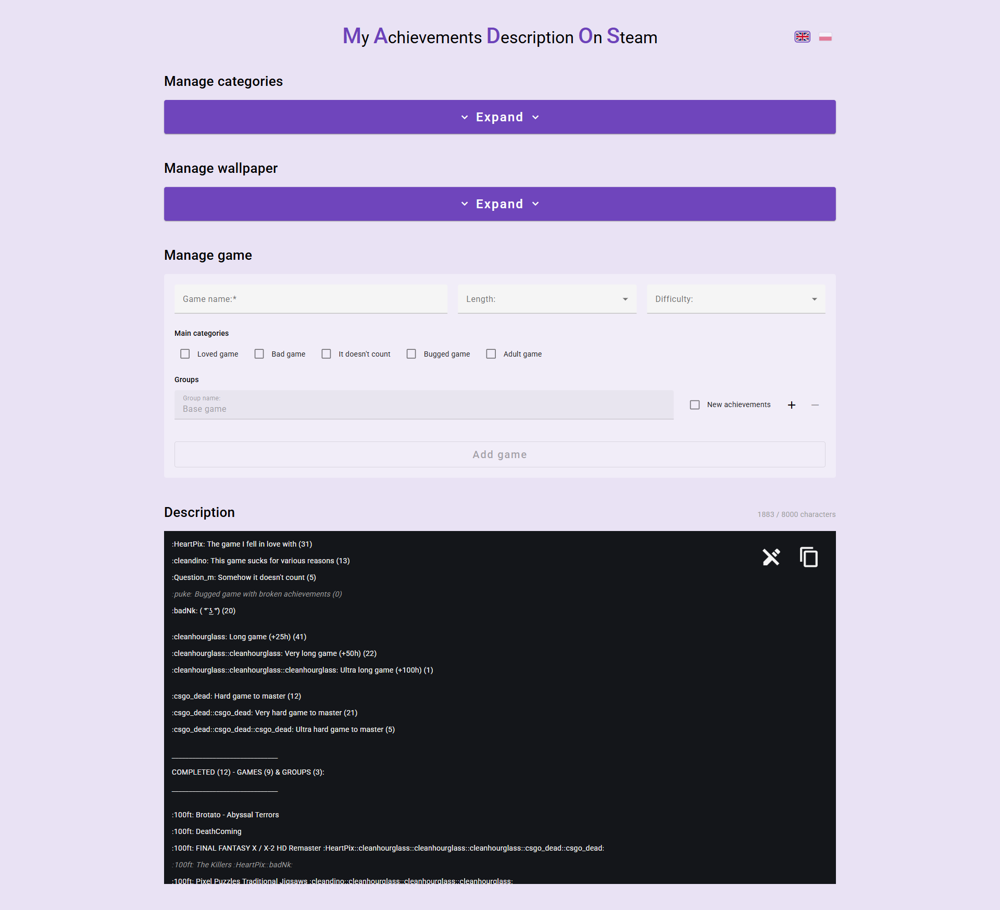

### Manage categories:

The 100% category and the main, length and difficulty categories, each kind with its own form. Categories are added and removed with the plus and minus buttons and reordered with drag & drop. Deleting a saved category needs a confirmation, and the category is unassigned from its games after saving.

| Manage Categories |
| --- |
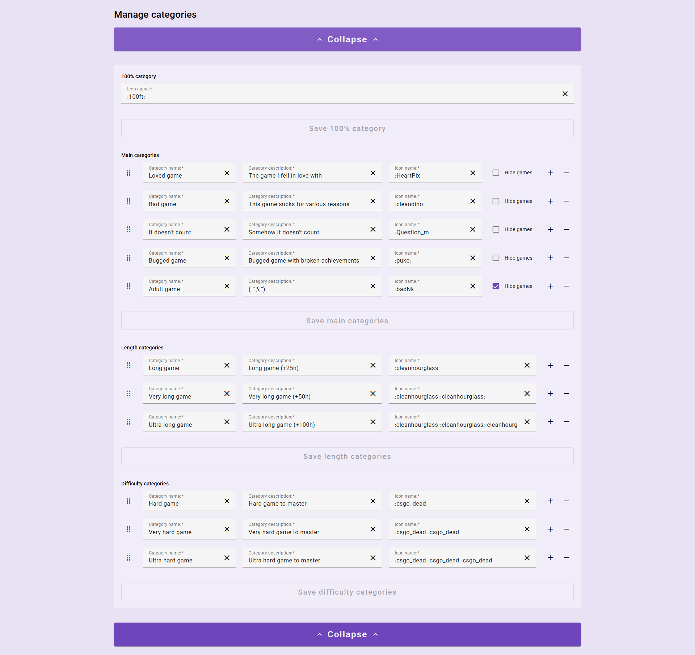

| Delete Category Confirmation |
| --- |
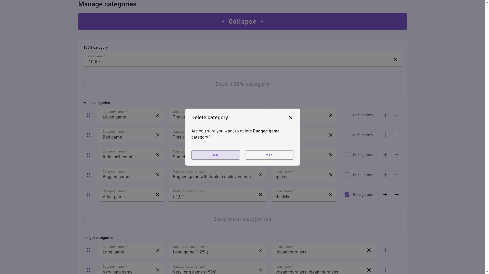

### Manage wallpaper:

Upload a GIMP 3 `.xcf` wallpaper or restore the default one, choose the category left out of the number in brackets, and preview, generate or download the `.png`.

| Manage Wallpaper |
| --- |
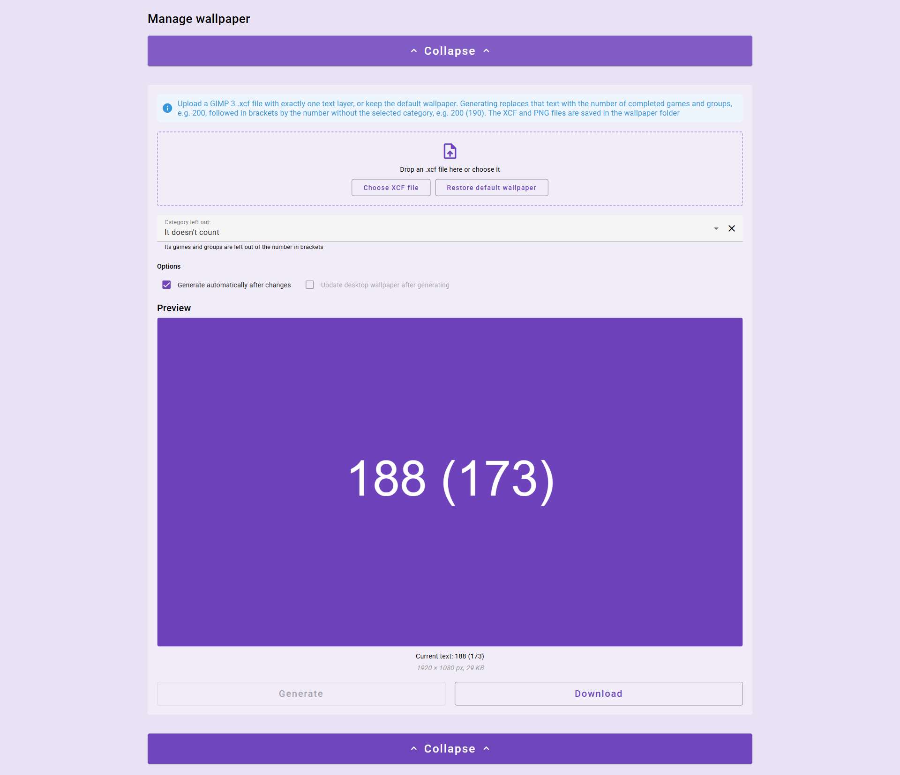

### Manage game:

A game needs only its name. Length, difficulty and main categories are optional. DLC groups are added below the Base game, and each one has its own New achievements checkbox.

| Manage Game Empty Form |
| --- |
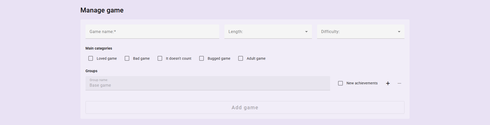

| Manage Game Filled Form |
| --- |
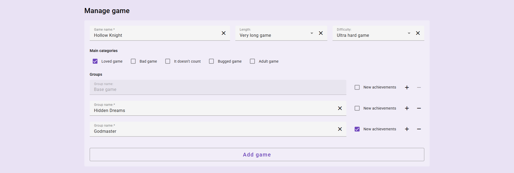

### Edit mode:

The pencil button in the description shows the edit and delete buttons next to every entry. Editing loads the game, with all its groups, into the Manage game form.

| Edit Game |
| --- |
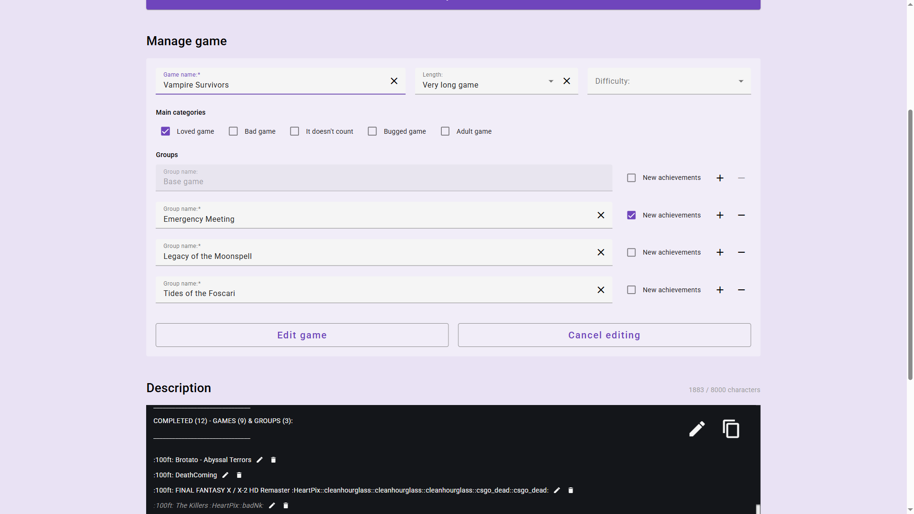

| Delete Game Confirmation |
| --- |
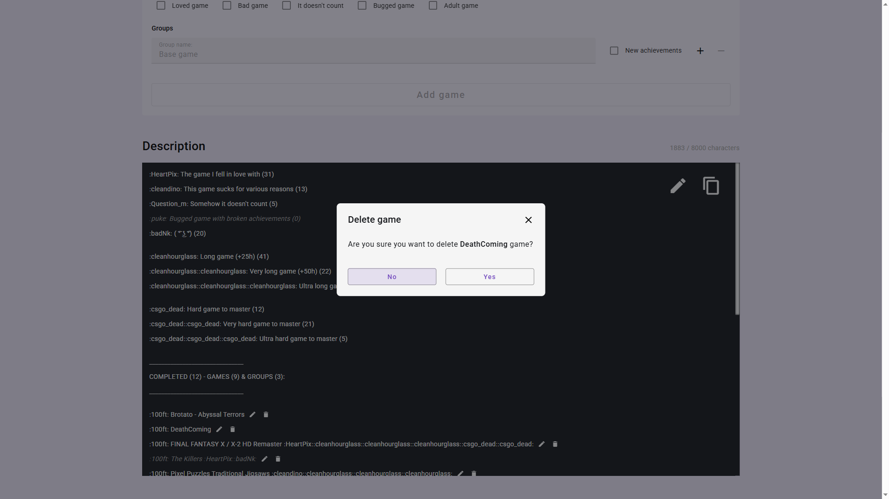

### Description:

The description is generated on the backend and copied with one click. Hidden information (categories with 0 games, hidden games and completed groups) is greyed out and never copied. The counter shows the Steam size of the copied description.

| Description |
| --- |
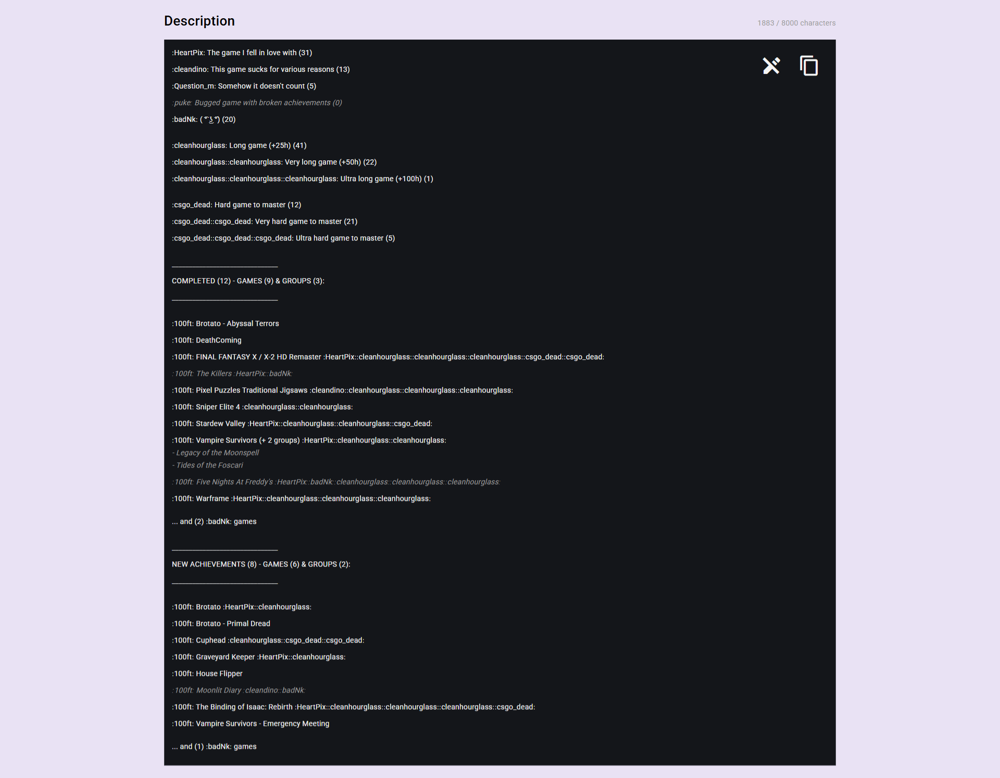

| Description Copied |
| --- |
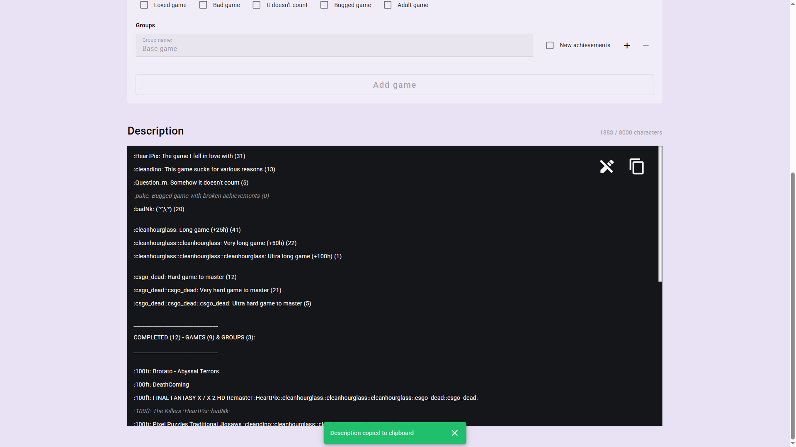

| Description Above The Steam Limit |
| --- |
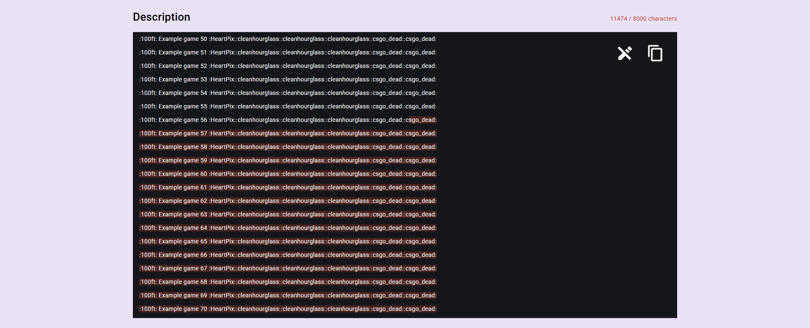

### Polish version:

| Polish Version |
| --- |
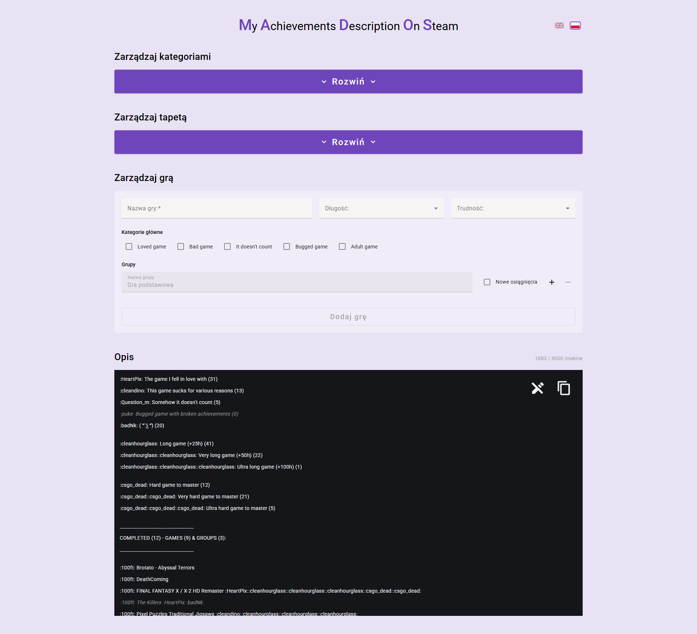

### Mobile view:

| Mobile View |
| --- |
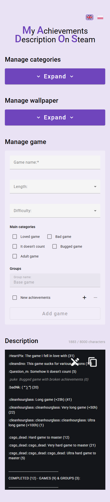

## Any questions?

If you have any questions or found some bugs or anything, feel free to contact me - I will be happy to answer :)
